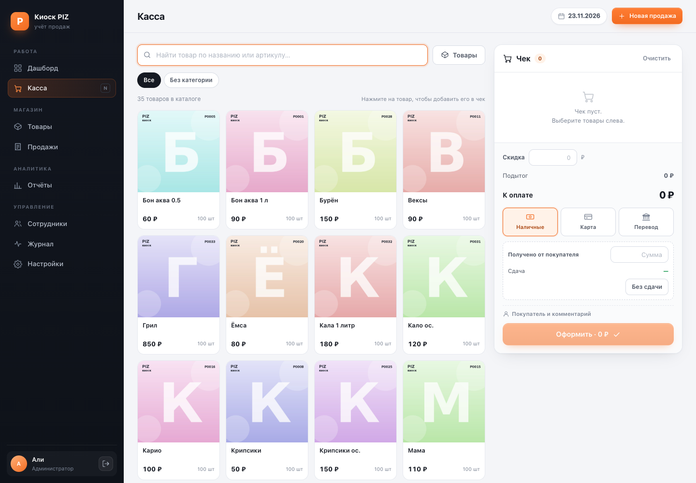
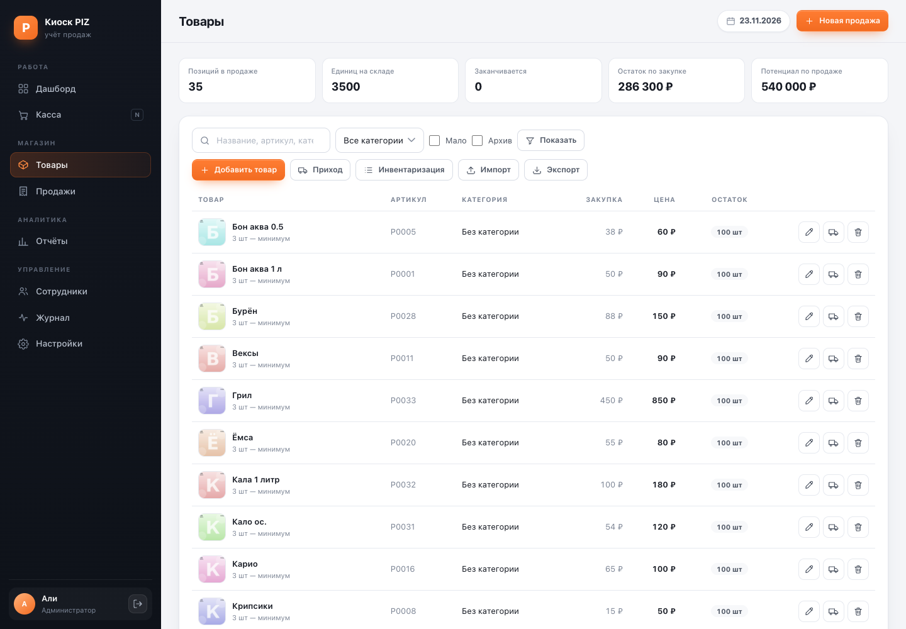

# PIZ — учёт продаж в киоске

Веб-сервис для небольшого киоска: продажи, остатки, прибыль, сотрудники и отчёты в одном окне.
Работает на обычном PHP-хостинге (Beget) без сборщиков и Composer.

- **Домен:** https://piz.itop7.ru (HTTPS, Let's Encrypt)
- **Репозиторий:** https://github.com/mahmadali91/piz
- **База данных:** MySQL, `mahmadgv_piz` (доступы — в файле `info.txt`, он не попадает в Git)

## Что умеет

- **Дашборд** — выручка, прибыль, средний чек, продажи, стоимость остатков, «пора докупить», топ товаров и график за 14 дней.
- **Касса** — поиск товара, чек, количество, скидка, оплата **наличными / картой / переводом**, расчёт сдачи, печать чека 80 мм.
- **Товары** — фото, категории, закупочная и продажная цена, минимальный остаток, приход, инвентаризация, архив.
- **Импорт из Excel** — `.xlsx` и `.csv` с автоматическим поиском заголовков; шаблон CSV скачивается из интерфейса.
- **Продажи** — история, фильтры, детали чека, отмена с возвратом товара на склад, экспорт CSV.
- **Отчёты** — выручка, прибыль, маржинальность, оплата по способам, топ товаров, склад, экспорт CSV и печать.
- **Сотрудники** — роли и точные права: кассир видит только кассу и свои продажи.
- **Журнал действий** — кто, что и когда сделал.
- **Безопасность** — пароли в виде хеша, CSRF-защита, ограничение попыток входа, защита загрузок и служебных файлов.

## Скриншоты




## Стек

| Слой | Технологии |
|---|---|
| Backend | PHP 8.1+ (запуск проверен на 8.5, синтаксис — на 8.2/8.3), PDO MySQL |
| База | MySQL 5.7+ / MariaDB 10.3+ |
| Frontend | чистый HTML/CSS/JS, без CDN и сборки |
| Фото | GD (перекодирование в JPEG) |
| Excel | ZipArchive + SimpleXML, без PhpSpreadsheet |
| Хостинг | Beget, Apache + mod_rewrite |

## Быстрый запуск локально

Нужны PHP 8.1+ с расширениями `pdo_mysql`, `mbstring`, `fileinfo`, желательно `gd` и `zip`, и MySQL.

```bash
# 1. Создайте пустую базу MySQL
# 2. Запустите встроенный сервер из корня проекта
php -S 127.0.0.1:8080 tools/dev-server.php
```

Откройте http://127.0.0.1:8080/setup и введите доступы к базе. Установщик создаст таблицы,
загрузит стартовый каталог из `data/products.csv` (35 товаров из `товар.xlsx`; дубль «Фейри 1 л (зачеркнуто)» исключён) и попросит создать администратора.

> `config/config.php` создаётся установщиком и игнорируется Git. Пароль базы в репозитории не хранится.

## Структура

```
index.php                 входная точка и роутинг
src/
  bootstrap.php           конфиг, сессия, БД, обработка ошибок
  Controllers/            контроллеры разделов и API
  Models/                 товары, продажи, пользователи
  Services/               импорт Excel/CSV, загрузка фото
  Views/                  шаблоны и partials (чек, график, иконки)
  Router.php, Auth.php, Permissions.php, Install.php …
assets/css/app.css        дизайн
assets/js/app.js          модальные окна, формы, тосты
assets/js/pos.js          касса (корзина, оплата, чек)
database/schema.sql       схема MySQL
data/products.csv         стартовый каталог (35 позиций из товар.xlsx)
config/config.example.php пример конфигурации (рабочий файл — config.php)
docs/                     инструкции по хостингу, GitHub и работе
uploads/                  фото товаров (не в Git)
storage/logs/             журналы PHP (не в Git)
```

## Роли и права

| Право | Администратор | Управляющий | Кассир |
|---|:---:|:---:|:---:|
| Касса и оформление продаж | ✅ | ✅ | ✅ |
| Просмотр товаров и остатков | ✅ | ✅ | ✅ |
| Добавление/редактирование товаров | ✅ | ✅ | — |
| Приход и инвентаризация | ✅ | ✅ | — |
| Закупочные цены и прибыль | ✅ | ✅ | — |
| Все продажи (не только свои) | ✅ | ✅ | — |
| Отмена продаж | ✅ | ✅ | — |
| Дашборд | ✅ | ✅ | — |
| Отчёты и экспорт | ✅ | ✅ | — |
| Сотрудники и права | ✅ | — | — |
| Настройки киоска | ✅ | — | — |
| Журнал действий | ✅ | — | — |

Права можно выдать точечно: в карточке сотрудника выберите роль «Свои права» и отметьте нужные пункты.

## Запуск на хостинге

1. [Инструкция по Beget](docs/DEPLOY_BEGET.md) — загрузка, база, PHP, SSL, обновления.
2. [Инструкция по GitHub](docs/GITHUB.md) — репозиторий, деплой-ключ, `git pull`.
3. [Руководство пользователя](docs/USER_GUIDE.md) — как продавать, принимать товар и смотреть прибыль.
4. [ИНСТРУКЦИЯ.md](ИНСТРУКЦИЯ.md) — единая инструкция по запуску и работе.
5. [ИСТОРИЯ.md](ИСТОРИЯ.md) — журнал запросов и ответов по проекту.

Коротко:

```bash
ssh mahmadgv@mahmadgv.beget.tech
cd ~/piz.itop7.ru
mv public_html public_html.backup
git clone https://github.com/mahmadali91/piz.git public_html
```

Затем откройте `http://piz.itop7.ru/setup`, введите данные базы из `info.txt` и создайте администратора.

## Проверка

- `GET /healthz` — состояние сервиса и подключения к БД.
- `Настройки → Система` — версия PHP/MySQL, наличие таблиц, права на запись.
- Журнал: `storage/logs/php-error.log`.

## Безопасность и данные

- `info.txt` и `config/config.php` **исключены из Git** и закрыты `.htaccess` от прямого доступа.
- Пароли хранятся через `password_hash()`, сессия — HttpOnly + SameSite, CSRF-токен на всех POST.
- Загрузки перекодируются в JPEG; в `uploads/` запрещено исполнение PHP.
- Делайте резервные копии базы и папки `uploads/` (панель Beget + экспорт CSV).

## Лицензия

Частный проект. Все права принадлежат владельцу киоска.
