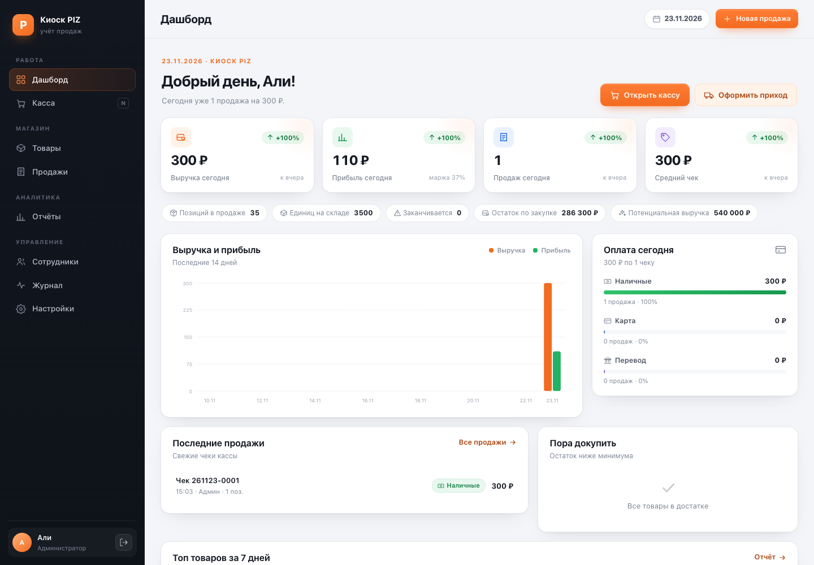
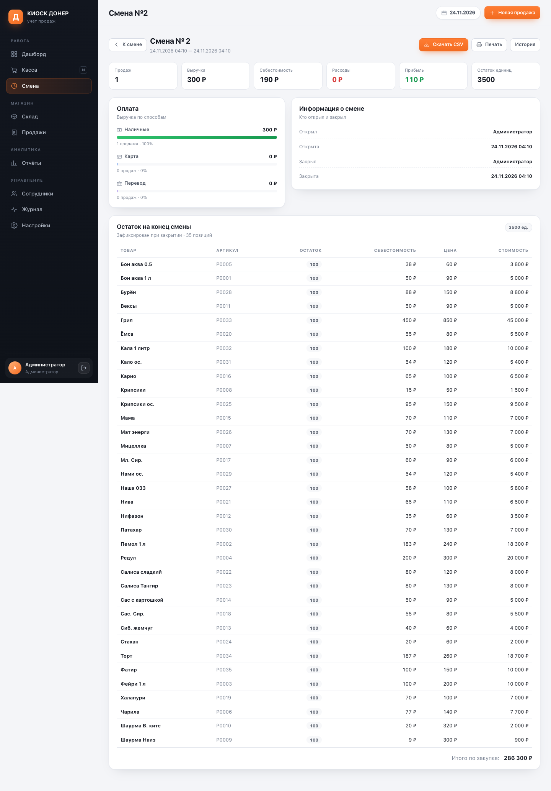
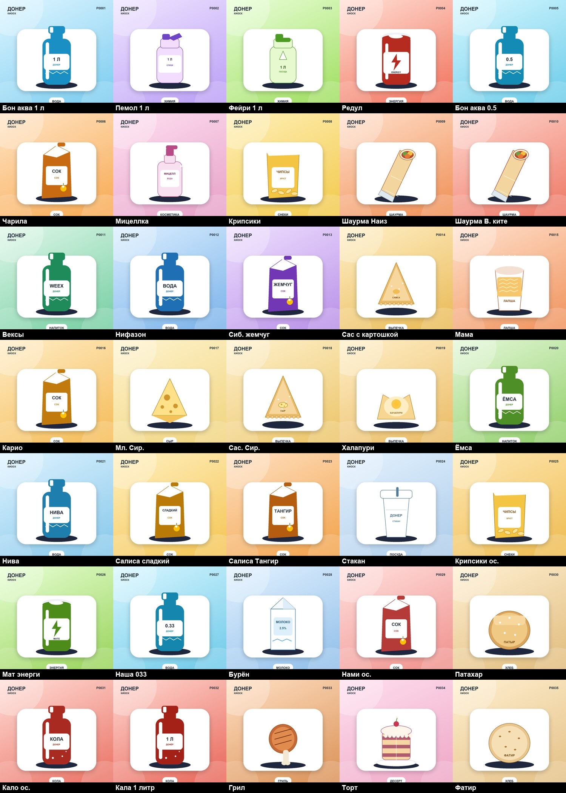
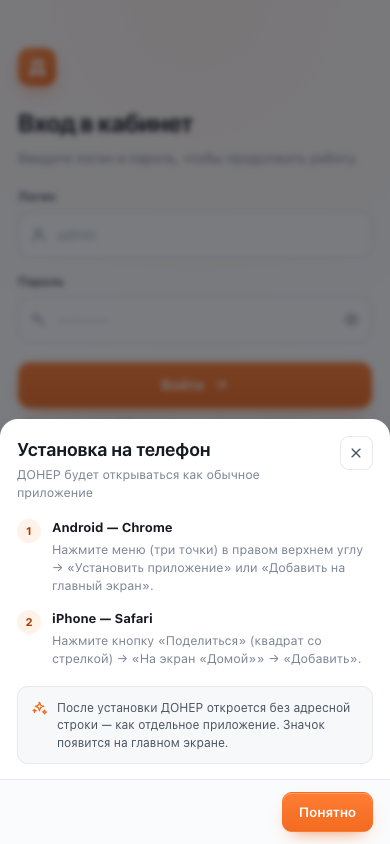
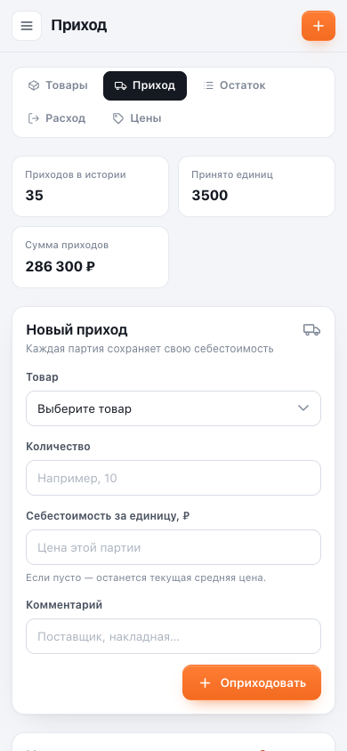

# КИОСК ДОНЕР — учёт продаж и склада

Веб-сервис для киоска: касса, товары, приход, расход, остатки, цены, смены, прибыль и сотрудники.
Работает на обычном PHP-хостинге (Beget) без Composer и сборщиков.

- **Домен:** https://piz.itop7.ru (HTTPS, Let's Encrypt)
- **Репозиторий:** https://github.com/mahmadali91/piz
- **База:** MySQL, `mahmadgv_piz` (доступы — в `info.txt`, в Git не попадает)

## Что умеет

- **Боковое меню** — сворачивается до иконок; разделы «Ещё» и меню администратора раскрываются по клику.
- **Дашборд** — выручка, чистая прибыль (за вычетом списаний), средний чек, остатки, расходы, топ товаров и график.
- **Касса** — поиск, чек, скидка, оплата наличными / картой / переводом, сдача, скачивание чека PDF. Разрешена продажа при нулевом/отрицательном остатке (настраивается).
- **Товары и остаток** — фото, категории, цены, остаток, архив, импорт Excel/CSV. В карточке товара сохраняется история изменения цен. Ползунок **«Массово»** открывает изменение цен для всех товаров.
- **Приход** — отдельный раздел: несколько товаров одной операцией, у каждой строки своя партия и себестоимость; ниже история приходов.
- **Расход** — отдельный раздел: несколько товаров одной операцией на сотрудника, личное использование, брак. Это **не продажа**: уменьшается остаток и учитывается расход, выручка не растёт.
- **Поставщики** — накладные, закупочные цены, оплаты и долг поставщику. Накладная автоматически создаёт приход и историю цен.
- **Инвентаризация** — документ: кто, когда, склад, расчётный и фактический остаток, расхождение, акт недостачи/излишка.
- **PDF** — чек, отчёт, цветной отчёт смены, накладная и акт инвентаризации; суммы с валютой «руб.».
- **Смены** — открытие/закрытие, отчёт с остатком на конец смены, CSV и PDF.
- **Права** — администратор может отдельно ограничить цены, приход, инвентаризацию, списание, поставщиков и смены. Администратор — суперпользователь.
- **Вход** — восстановление пароля по ссылке из письма; в футере разработчик Ali и Telegram @kobilov_ali.
- **Безопасность** — bcrypt, CSRF, лимит попыток входа, защита загрузок и служебных файлов.

## Скриншоты







## Мобильная версия и установка

Сервис устанавливается на телефон как PWA — без магазинов приложений.

- **Android / Chrome:** баннер «Установить ДОНЕР» или меню ⋮ → «Установить приложение».
- **iPhone / Safari:** «Поделиться» → «На экран «Домой»».
- Отдельная иконка, полноэкранный режим, офлайн-заглушка.
- Проверено на 390×844: все разделы без горизонтальной прокрутки, товары и продажи — карточками.




## Роли

| Роль | Доступ |
|---|---|
| Администратор | всё, включая сотрудников, настройки и права; суперпользователь |
| Управляющий | касса, товары, склад, цены, списания, смены, отчёты, отмена продаж |
| Кассир | касса, просмотр товаров, списание, смена; цены и склад — по желанию администратора |
| Свои права | любые отмеченные пункты |

## Стек

| Слой | Технологии |
|---|---|
| Backend | PHP 8.1+ (проверено на 8.2/8.5), PDO MySQL |
| База | MySQL 5.7+ / MariaDB 10.3+ |
| Frontend | HTML/CSS/JS без CDN и сборки |
| Фото | GD |
| Excel | ZipArchive + SimpleXML |
| PWA | manifest, service worker `/sw.php`, офлайн-страница |
| Хостинг | Beget, Apache + mod_rewrite |

## Быстрый запуск

```bash
# 1. Создайте пустую базу MySQL
# 2. Запустите встроенный сервер из корня проекта
php -S 127.0.0.1:8080 tools/dev-server.php
```

Откройте http://127.0.0.1:8080/setup и укажите доступы к базе. Установщик создаст таблицы,
загрузит каталог из `data/products.csv` (35 позиций) и попросит создать администратора.

### Обновление существующей базы

```bash
php8.2 tools/migrate.php
```

Миграция добавляет таблицы приходов, списаний, смен, поле `sales.shift_id`, настройку
отрицательных остатков и переименовывает киоск в **КИОСК ДОНЕР**. Данные товаров,
продаж и пользователей сохраняются.

## Структура

```
index.php                 входная точка
src/
  bootstrap.php           конфиг, сессия, БД, ошибки
  Controllers/            касса, товары, склад, цены, смены, отчёты
  Models/                 Product, Sale, Receipt, Writeoff, Shift, User
  Services/               импорт Excel/CSV, загрузка фото
  Views/                  шаблоны, partials, stock/, shift/
  Permissions.php         права и роли
assets/css/app.css        дизайн
assets/js/app.js          модальные окна, формы
assets/js/pos.js          касса
database/schema.sql       схема MySQL
data/products.csv         стартовый каталог
tools/migrate.php         миграция существующей базы
tools/maintenance.php     CLI: остатки, фото, пользователи
dist/                     ZIP для хостинга
docs/                     инструкции и скриншоты
```

## Архив проекта

Всё хранится внутри папки `PIZZA`:

- `archive/requests/ЗАПРОСЫ.md` — все запросы заказчика;
- `ИСТОРИЯ.md` — полная переписка и решения;
- `archive/instructions/` — копии инструкций;
- `archive/versions/piz-full-history.bundle` — полная история Git;
- `dist/piz-kiosk-v1.24.26-16.zip` — текущая сборка (локально, на сайт не выкладывается);
- `temp/` — только временные файлы проекта.

Подробная карта архива: [archive/README.md](archive/README.md).

## Документация

- [Отчёт по токенам и стоимости](docs/TOKEN_REPORT.md) — фактические токены, доллары и правила экономии.
- [План развития по HoReCa](docs/ROADMAP_HORECA.md) — что внедрять из практик ресторанных систем.
- [AGENTS.md](AGENTS.md) — правила работы без повторного чтения истории.
- [PROJECT_BRIEF.md](PROJECT_BRIEF.md) — краткий бриф для новой сессии.

- [ИНСТРУКЦИЯ.md](ИНСТРУКЦИЯ.md) — установка, работа, склад, смены, права.
- [ИСТОРИЯ.md](ИСТОРИЯ.md) — все запросы и ответы по проекту.
- [docs/USER_GUIDE.md](docs/USER_GUIDE.md) — руководство продавца.
- [docs/DEPLOY_BEGET.md](docs/DEPLOY_BEGET.md) — Beget.
- [docs/GITHUB.md](docs/GITHUB.md) — Git и деплой.

## Статус

- **Версия сайта: v1.24.26-16** (файл [VERSION](VERSION), описание — [VERSION.md](VERSION.md)).
- 35 товаров, 3500 единиц, 35 фото.
- 1 реальная продажа; существующие пользователи не изменялись.
- HTTPS, HTTP → HTTPS 301, HSTS, cookie `Secure`.
- CI GitHub Actions зелёный.
